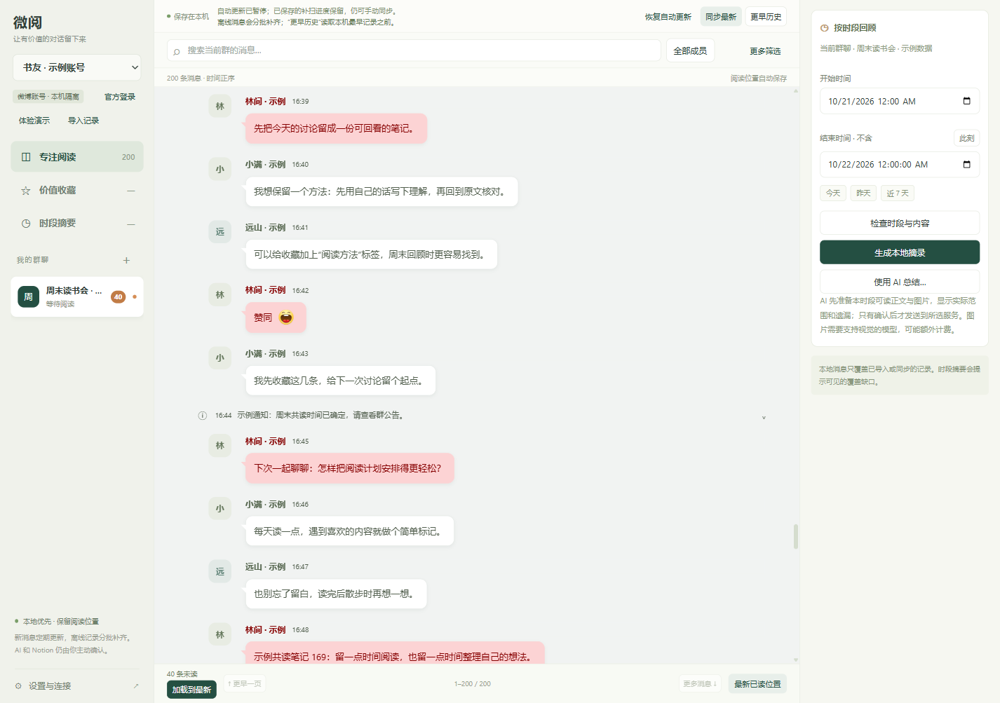

# 微阅 Windows

**WeiYue Windows 1.1.26** 是本地优先的微博群聊阅读应用：专注读群聊、保存有价值的内容、按指定时段回顾。

**固定一个日常安装目录。** 每个 portable 目录使用独立的 `data/`。升级前正常退出并完整备份，再更新程序文件、保留原 `data/`；新解压目录不会带入旧资料，不要用旧数据覆盖已有新资料。

| 功能 | 用法 |
| --- | --- |
| 阅读与更新 | 官方网页登录后选择群聊，按成员、关键词和北京时间分钟筛选；键盘或鼠标触顶/触底双向翻页，返回“最新已读位置”。当前群正常一轮完成后 5 秒再检查，其他群约 60 秒轮转；实际包含网络耗时、补扫和退避，不是全部群固定 5 秒推送。 |
| 收藏与时段摘要 | 单条或多条收藏、备注、标签、原文回查；按时段生成本地摘录。使用自配 AI 前核对内容；摘要或收藏可编辑预览后确认导出到自己的 Notion 页面。 |
| 文档附件 | XLSX 显示只读缓存值，CSV 显示表格，Markdown 显示安全原文；支持编码识别、截取提示和原件保存，不执行公式、宏、HTML 或远程内容。 |
| 实况照片与语音 | 支持确证 MOV/QuickTime 实况源和分享语音附件。短 HEVC 与 AMR 可在本机受限转换后播放，关闭或切换停止旧媒体，另存仍保留原件。 |
| 表情 | 新增 `[/ee9095.png]`、`[/ee8cbe.png]`、`[/ee84bc.png]`、`[/ee9094.png]` 四张官方原图；共 413 映射、412 去重资源。复制和导出保留原代码，未知代码回退文字。 |
| 界面与独立配色 | 设置 → 编辑主题与颜色，选择 Cool Grey、Viridian、Pink 或 Violet；先预览，保存到当前账号。七项消息颜色独立保留，取消不保存，主题和消息颜色分别恢复默认；左上口号已移除。 |
| 本地数据管理 | 默认可恢复回收，也可选择永久删除或清空所选回收批次。按群、分钟时间与保留规则预览数量再确认；显示实际进度，完成后刷新当前群。保留大群快照缓存与有界消息分页。 |

没有账号或服务配置，也可使用演示数据、JSON 导入、收藏和本地摘录。见[中文使用说明](docs/使用说明.md)、[1.1.26 更新说明](docs/1.1.26更新说明.md)与[安全说明](docs/安全与限制.md)。

## 界面示例

沿用已公开的 1.1.21 正式账号界面合成图，全部为**示例数据**，仅供阅读布局参考；不是本版主题或新附件控件的验收截图。没有使用真实群聊、账号或新截图。



## 使用与升级

1. 从[发行页](https://github.com/Roselis2l/weiyue-windows/releases)下载同批 `WeiYue-Windows-x64.zip` 和 `SHA256SUMS.txt`，核对校验值。
2. 完整解压并运行 `WeiYue-Windows-x64/WeiYue.exe`。Windows x64 包含运行时，无需安装 Node.js。
3. 若已有安装，先正常退出、备份整个目录，只更新程序文件并保留原 `data/`。不要同时从多个副本日常使用。

软件未使用代码签名证书，请核对来源并遵循设备安全策略。**永久删除不可恢复**，只保留群 ID、消息 ID 和时间的最小标记防止同步补回，不是磁盘安全擦除。首次回收升格式 2，1.1.16 及更早不能读取；首次非空永久删除升格式 3，1.1.24 及更早不能读取。降级须用对应操作前的完整备份并另外保留当前资料；本版不新增账号格式迁移。

## 本地优先与支持边界

聊天按账号保存在本机；Cookie 和服务密钥使用 Windows 保护存储，业务数据与导出文件没有整体加密。AI 仅在核对内容并确认后发送到用户配置的服务，Notion 仅在编辑预览确认后写入；没有默认定时发送。媒体在本机处理，不会因可预览而自动提交给 AI。

- XLSX 原件限 20 MiB，MD/CSV 限 5 MiB；预览限制工作表、行列、单元格和文本长度，截取会提示。只显示缓存值，不复刻完整 Excel 排版；超读取上限不下载。
- 视频兼容转换限 20 MiB、30 秒及尺寸等条件；音频原件限 20 MiB，AMR 转换另限 10 MiB、5 分钟。转换在本机隔离任务内完成，失败不循环重试；原件保持不变。
- 缺少官方关联字段、失效、无权限或未知编码时仍可能无法播放或打开引用原图，不猜地址、不绕过拒绝。旧语音可按“补全这条分享”获取可用元数据。被永久删除的消息不会因兼容更新自动恢复。
- 四主题为 Chrome 风格自主配色，不声称精确复刻。表情为已验证静态资源，不声称覆盖所有专属、付费、自定义或动态目录。

## 测试与构建

本版本地全量单测 **1154/1154** 通过；最终 EXE 已验收文档 12 项、媒体 11 项、主题 7 项、分页 10 项、表情 7 项及重启 3 项，旧媒体/PDF/HEIF 回归 25 项。媒体格式使用本机授权原件在隔离环境中验证，公开包不含这些原件；其他界面测试使用合成数据。未调用真实 AI/Notion，不以本地测试代替 CI。详见[测试说明](docs/TESTING.md)。

Node.js 22+、PowerShell 5.1+ 可运行核心测试：

```powershell
./scripts/test.ps1
```

将已核验的 Electron 44.9.0 官方 Windows x64 ZIP 与同版 `SHASUMS256.txt` 放入干净源码副本的 `vendor/` 后构建：

```powershell
./scripts/package.ps1 -ElectronVersion 44.9.0 -OutputDirectory dist-1.1.26
```

发行材料仅整理公开文档，应用、测试、脚本及许可证保持已验收构建字节。源码与便携包不得包含用户数据、凭据、私有媒体、诊断日志或备份。

## 来源与许可

参考 [ylj5244-dot/weiyue](https://github.com/ylj5244-dot/weiyue)，并非原项目官方 Windows 发行版。[原作 MIT 版权](docs/REFERENCE-LICENSE.txt)完整保留。Electron/Chromium、[HEIC](docs/HEIF-THIRD-PARTY.md)、[PDF.js](docs/PDFJS-THIRD-PARTY.md)、[sax 文档解析](docs/DOCUMENT-THIRD-PARTY.md)及[FFmpeg 媒体兼容组件](docs/FFMPEG-THIRD-PARTY.md)分别遵循随附许可；FFmpeg 按 GPL-2.0-or-later 分发并附对应源码，整套包不能称为全部 MIT。[官方表情资源](docs/WEIBO-EMOTICONS.md)权利归原权利人。
