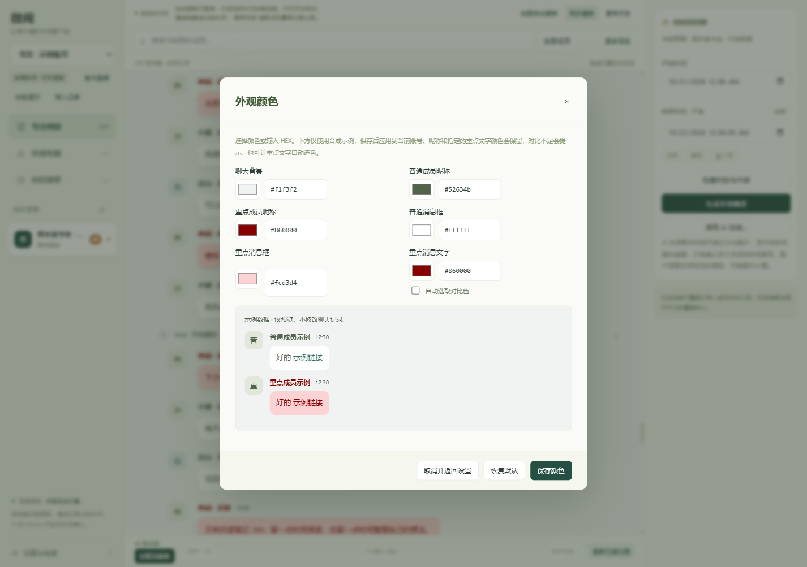

# 微阅 Windows

**WeiYue Windows 1.1.21** 是本地优先的微博群聊阅读应用，专注读群聊、保存有价值的内容、按指定时段回顾。

**固定一个日常安装目录。** 每个 portable 目录使用独立的 `data/`。升级前正常退出并完整备份，再更新程序文件、保留原 `data/`；新解压目录不会自动带入旧资料，也不要用旧数据覆盖已有新资料。

| 功能 | 用法 |
| --- | --- |
| 阅读与同步 | 官方网页登录后选择群聊，按成员、关键词和北京时间分钟筛选；返回“最新已读位置”。向下滚轮触底，或空白拖动到底并松开后，追加下一页最多 160 条本地消息；网络补扫另有入口。 |
| 消息外观 | 紧凑气泡保留字号和媒体尺寸；设置中分别调整聊天背景、普通/重点昵称、普通/重点气泡和重点正文。预览后保存，取消不生效。 |
| 价值收藏 | 收藏单条或多条消息，添加备注和标签，搜索、导出 Markdown / JSON，并回到本地原文。 |
| 时段摘要 | 指定时段生成本地摘录；使用 AI 时先核对待发送内容。摘要或收藏可编辑预览后导出到自己的 Notion 页面。 |
| 媒体查看 | 图片缩放、PDF 翻页、视频及实况照片预览；可保存原文件或下载受支持的压缩附件。网页链接交给默认浏览器。 |
| 本地回收 | 按群与分钟范围预览、保留重要来源，再确认移入可恢复回收区；自动同步不会重新显示已回收消息。 |

没有账号或服务配置，也可使用演示数据、JSON 导入、收藏和本地摘录。完整操作见[中文使用说明](docs/使用说明.md)，本轮功能见[更新说明](docs/1.1.21更新说明.md)。

## 界面示例

以下图片由最终 1.1.21 的正式账号界面路径渲染，账号、群名、成员与内容均为完全合成的**示例数据**，同步暂停，没有真实聊天或登录资料。




## 开始使用

1. 在[发行页](https://github.com/Roselis2l/weiyue-windows/releases)取得同批次 `WeiYue-Windows-x64.zip` 和 `SHA256SUMS.txt`，核对校验值。
2. 完整解压后运行 `WeiYue-Windows-x64/WeiYue.exe`。Windows x64 包含运行时，无需安装 Node.js。
3. 需要自己的消息时，打开“官方登录”，自行完成微博验证并选择同步群聊。

软件未使用代码签名证书；请核对来源、遵循设备安全策略。回收区是可恢复隐藏，不释放磁盘空间；首次实际回收后账号格式升为 2，1.1.16 及更早版本不能读取，降级须使用启用回收前的完整备份。

## 本地优先与边界

聊天按账号保存在本机；Cookie 和服务密钥使用 Windows 保护存储，业务数据与导出文件没有整体加密。AI 只在核对内容并确认后发送到用户配置的服务，Notion 只在编辑预览确认后写入；没有定时 AI 或 Notion 发送。媒体在本机处理，不因可以预览而自动提交给 AI。

缺少原消息 ID 或原图地址的引用仍无法打开，不猜测配图。未知或加载失败的表情保留原代码，不保证全部聊天表情覆盖。短 HEVC 本机兼容预览受 20 MiB、30 秒及尺寸等限制；不保证所有编码、失效链接或服务器历史都可读取。具体范围见[安全与限制](docs/安全与限制.md)。

## 源码测试与构建

需要 Node.js 22+、PowerShell 5.1+。核心测试无需 `npm install`：

```powershell
./scripts/test.ps1
```

将 Electron 44.9.0 官方 Windows x64 ZIP 与同版 `SHASUMS256.txt` 放入干净源码副本的 `vendor/` 后执行：

```powershell
./scripts/package.ps1 -ElectronVersion 44.9.0 -OutputDirectory dist-1.1.21
```

本地全量单元 943 项、最终 EXE 126 项验收通过；使用隔离数据，未调用真实付费 AI 或写入真实 Notion。范围与限制见[测试说明](docs/TESTING.md)。分发包不得包含用户数据、凭据、私有截图或备份。

## 来源与许可

参考 [ylj5244-dot/weiyue](https://github.com/ylj5244-dot/weiyue)，并非原项目官方 Windows 发行版。[原作 MIT 版权许可](docs/REFERENCE-LICENSE.txt)完整保留。Electron/Chromium、[HEIC](docs/HEIF-THIRD-PARTY.md)、[PDF.js](docs/PDFJS-THIRD-PARTY.md)与[FFmpeg 兼容组件](docs/FFMPEG-THIRD-PARTY.md)分别遵循随附许可；FFmpeg 组件按 GPL-2.0-or-later 分发并附对应源码，整套包不能称为完全 MIT。[官方表情资源](docs/WEIBO-EMOTICONS.md)的权利归原权利人。
