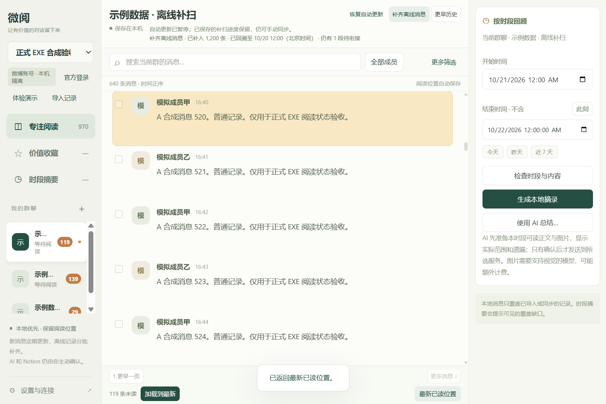
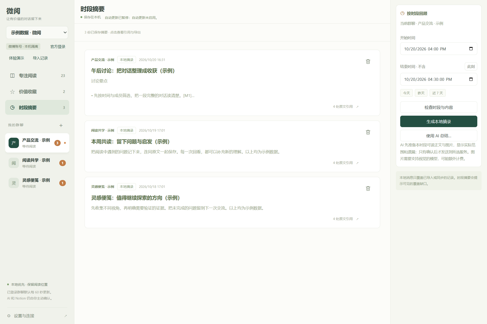
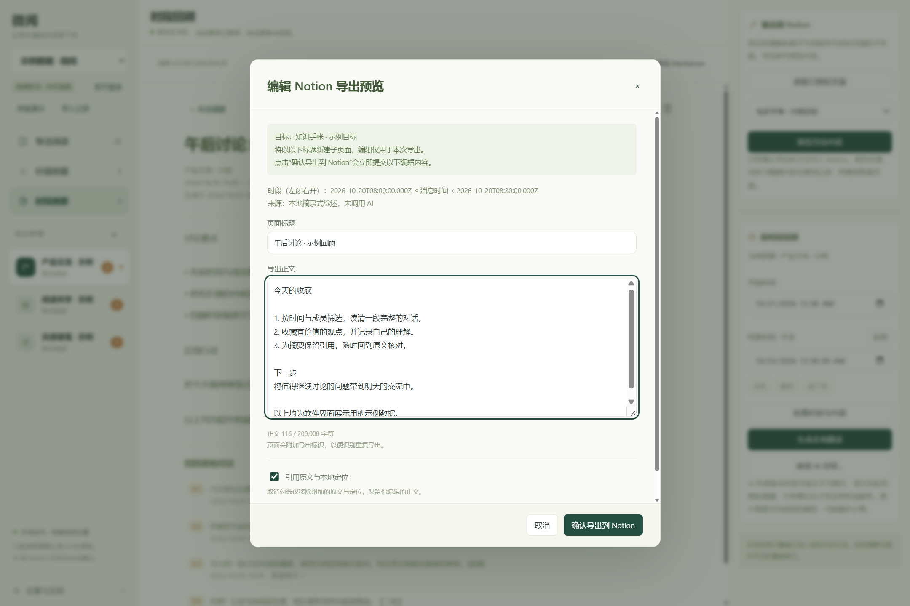

# 微阅 Windows

**WeiYue Windows 1.1.16** 是本地优先的微博群聊阅读应用，专注三件事：读群聊、保存有价值的内容、按指定时段回顾。离线消息采用有预算的连续分页，兼顾实时消息与中段补扫；界面显示补扫状态，并区分“补齐离线消息”和“更早历史”。实际验证结果与限制见 [1.1.16 更新说明](docs/1.1.16更新说明.md)，复验方法见 [TESTING.md](docs/TESTING.md)。

**请固定一个日常安装目录。**每个 portable 目录各自保存 `data/`，解压到新目录会创建独立资料。升级时先正常退出、备份整个现有安装目录，再用新版程序文件更新该固定目录并保留原 `data/`；不要同时从多个副本日常使用，也不要用旧 `data` 覆盖已经产生新资料的目录。

| 功能 | 用法 |
| --- | --- |
| 专注阅读 | 在微博官方页面自行登录，选择有权访问的群聊同步到本机；按多个成员、北京时间的起止分钟、关键词筛选，标记重点成员，记住各群阅读位置。 |
| 最新已读位置 | 中间栏右下角返回本群最新读到的消息；必要时清除筛选，保留后续未读。“加载到最新”则会显式读到当前最后一条。 |
| 图片查看 | 在独立大窗口中缩放、适应窗口、查看原始大小、拖动平移，并通过系统“另存为”保存原图。 |
| PDF 与视频 | 对可读取的受支持附件，打开独立 PDF 翻页/缩放窗口或带控制的视频播放器，并可另存原文件。 |
| 网页链接 | 消息中的 HTTP / HTTPS 地址点击后交给系统默认浏览器。 |
| 价值收藏 | 收藏单条或多条消息，添加备注和标签，搜索收藏，导出 Markdown / JSON，回到本地原文。 |
| 时段摘要 | 选择起止时间，检查覆盖范围并生成本地摘录；使用 AI 时先准备可读取的分享正文与图片，核对范围及遗漏后确认发送。 |
| Notion 导出 | 配置自己的 integration，选择已授权页面，核对编辑预览后点击“确认导出”直接发送摘要或收藏，不再额外勾选确认或弹出第二次确认。 |

首次运行提供虚构演示数据。没有微博、AI 或 Notion 配置，也可以使用演示、JSON 导入、阅读、收藏和本地摘录。

## 界面示例

以下图片使用正式微博账号工作区的界面路径，账号、群名、成员和内容均为完全合成的**示例数据**；同步处于暂停状态，没有展示真实群聊或登录资料。



[分钟筛选和成员多选示例](docs/images/reading-weibo-sample.png)（1.1.15 界面示例，相关功能继续保留）。





[查看摘要删除确认示例](docs/images/summary-delete-weibo-sample.png)。Notion 目标和正文也是模拟资料，没有写入真实工作区。

## 开始使用

Windows x64 portable 包包含运行时，无需安装 Node.js：

1. 取得同一批次的 `WeiYue-Windows-x64.zip` 与 `SHA256SUMS.txt`，核对校验值。
2. 完整解压到当前 Windows 用户可写的目录。
3. 双击 `WeiYue-Windows-x64/WeiYue.exe`，先使用演示工作区体验。
4. 需要自己的群聊时，选择“官方登录”，在微博官方窗口完成登录，再返回读取群聊并选择同步范围。

本项目未使用代码签名证书。请遵循设备安全策略，核对来源和校验值，不要关闭系统安全保护。升级前完全退出应用并备份整个 `data/`；保留旧版直到确认新版可用。

详细操作见 [中文使用说明](docs/使用说明.md)，数据保存和网络范围见 [安全与限制](docs/安全与限制.md)，本轮变化及验证边界见 [1.1.16 更新说明](docs/1.1.16更新说明.md)。从公开版 1.1.8 升级的用户可先读 [近期版本功能](docs/RELEASE-NOTES-1.1.15.md)。

## 本地优先

聊天、收藏、摘要和阅读位置保存在本机，并按账号隔离。微博 Cookie、AI Key 和 Notion Token 使用 Windows 保护存储；聊天正文、导出文件和另存为的图片没有加密。

本地摘录不联网。AI 总结先准备所选时段的聊天文本、可读取的分享微博正文和图片，显示范围与遗漏；仅在确认后将所列内容发送给选定服务。图片可能增加 token 用量和费用，不自动切换服务、额外调用 OCR 或失败后重试。Notion 仅在预览确认后写入。没有定时 AI 总结或定时 Notion 发送；微博账号的已选群聊默认每 60 秒只读更新，可以暂停。

头像通过独立的账号隔离代理按需读取，暂存内存，不作为聊天附件或 AI 图片输入。图片、PDF 与视频按需读取，可手动另存为，但不构成完整离线媒体归档。HEIC 解码、PDF 解析和视频播放在本机完成；不会因此把附件发给 AI 或 Notion。只访问当前账号有权限的群聊，不绕过登录验证、群权限或风控。

## 源码测试与构建

应用使用 Electron、Node.js 内置模块及随源码提供的固定版本 libheif-js / PDF.js。运行应用或核心测试不需要执行 `npm install`，也不在启动时下载解码器。核心测试需要 Node.js 22 或更新版本、PowerShell 5.1 或更新版本：

```powershell
./scripts/test.ps1
# Node 不在 PATH 时，传入自己的路径：
./scripts/test.ps1 -NodePath 'C:/路径/node.exe'
```

打包使用已核验的 Electron 44.9.0 官方 Windows x64 ZIP 和同版本 `SHASUMS256.txt`，放入源码 `vendor/`。在经过审查、不含真实数据的干净源码副本中执行：

```powershell
./scripts/package.ps1 -ElectronVersion 44.9.0 -OutputDirectory dist-1.1.16
```

输出为 `dist-1.1.16/WeiYue-Windows-x64/`、portable ZIP、源码 ZIP 和 `SHA256SUMS.txt`。已有输出不得覆盖，应使用新的干净目录。便携版读取其 EXE 同级 `data/`，解压到新目录不会自动带入旧数据；日常使用应固定同一目录，迁移前退出程序并备份。构建脚本执行成功不等于实际 EXE 验收通过；最终版本、ZIP 校验和、UI 检查及安装升级结果以同次交付报告为准。

源码与发布包不得包含用户数据、凭据、浏览器会话、诊断结果、真实截图、备份或内部工作区。运行时许可和参考仓库 MIT 许可必须保留。

## 验证边界

本版核心测试 673 项及最终 EXE 补扫界面 11 项通过，版本与沙箱启动校验通过。具体执行时点、其他桌面回归和未验证范围见 [1.1.16 更新说明](docs/1.1.16更新说明.md)，复验方法见 [TESTING.md](docs/TESTING.md)。

- 真实群与成员头像字段仍待联调，不能保证所有历史记录或接口响应都包含可显示头像。
- 文件扩展名和服务端 MIME 不一定代表实际编码。HEIC 支持依赖严格文件头识别及本地解码，不代表支持所有 HEIF 编码、AVIF 或损坏文件。原图片上限 20 MiB，本地转换显示 PNG 上限 64 MiB，像素及解码时间另有限制。
- PDF 上限 50 MiB；视频上限 200 MiB，仅处理受支持的 MP4 / WebM。具体视频编码能否播放取决于 Electron；加密、损坏、失效或无权限附件可能无法读取。PDF 不执行活动脚本，不保证所有表单、动画或交互效果。
- AI / Notion 自动化使用模拟服务，未调用真实付费 AI 或写入真实 Notion 工作区。
- AI 图片输入仍支持 JPEG、PNG、WebP；GIF、HEIC、PDF 和视频不会因本地可显示就自动发送给 AI。查看发送前范围与遗漏提示。
- 微博接口、权限和媒体链接可能变化；摘要只覆盖已同步或导入且成功准备的内容，结果应结合引用核对。
- 本次公开表情目录全部为 PNG；登录后专属或动态 GIF 表情目录尚未取得，不能据公开目录宣称覆盖全部微博表情。来源、数量和边界见 [微博表情说明](docs/WEIBO-EMOTICONS.md)。

## 来源与许可

本项目参考 [ylj5244-dot/weiyue](https://github.com/ylj5244-dot/weiyue) 的产品思路和微博群聊协议，参考提交为 `7b6c7203490b9110f3b109e53b0e24b4aad1ccac`。原项目面向 macOS；本项目是 Electron / Node.js 的 Windows 实现，并非原项目官方 Windows 发行版。

[MIT 版权与许可](docs/REFERENCE-LICENSE.txt) 完整保留。Windows 实现由 WeiYue Windows contributors 维护；Electron、Chromium、[HEIC 解码库](docs/HEIF-THIRD-PARTY.md)及 [PDF.js](docs/PDFJS-THIRD-PARTY.md) 分别适用随附许可。HEIC 解码库的对应源码、许可和重建材料随包提供。[微博表情图片](docs/WEIBO-EMOTICONS.md) 的权利归原权利人，不由项目 MIT 许可重新授权。正式发行文件见 [GitHub Releases](https://github.com/Roselis2l/weiyue-windows/releases)，请核对所选版本与附件校验值。
